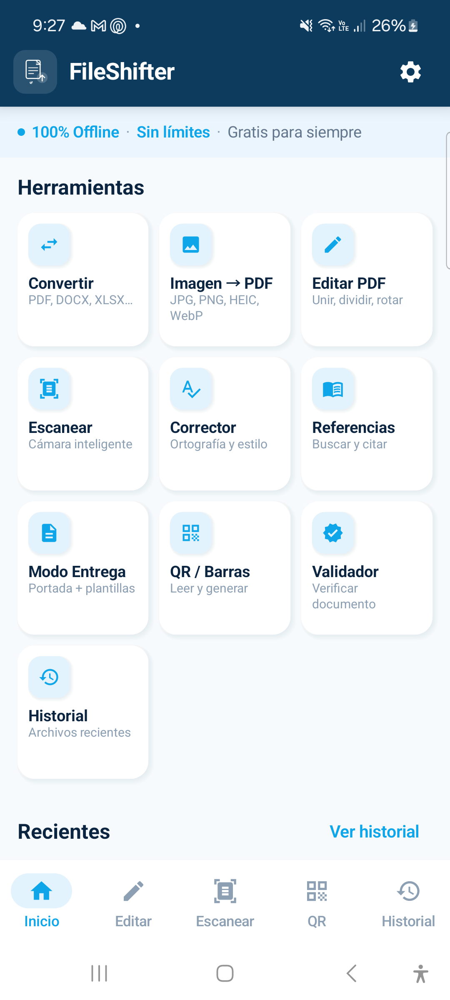
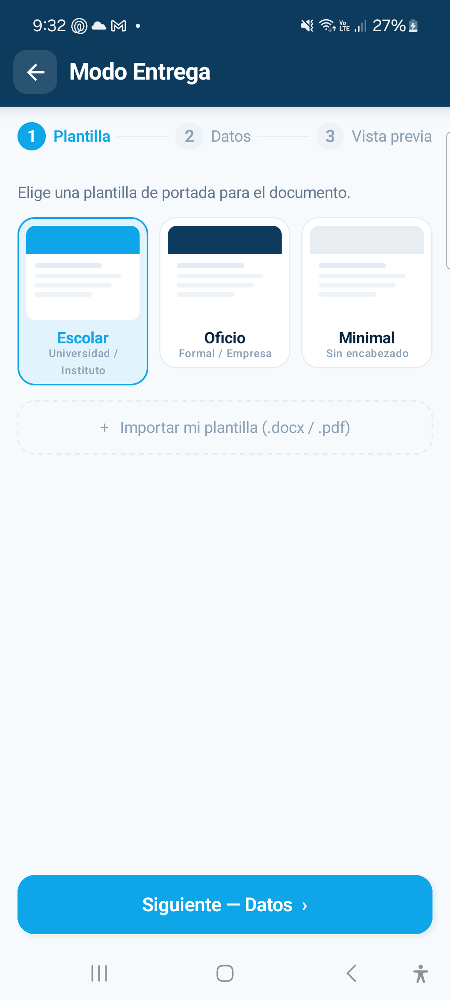
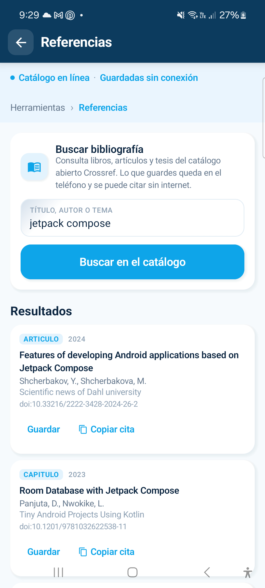
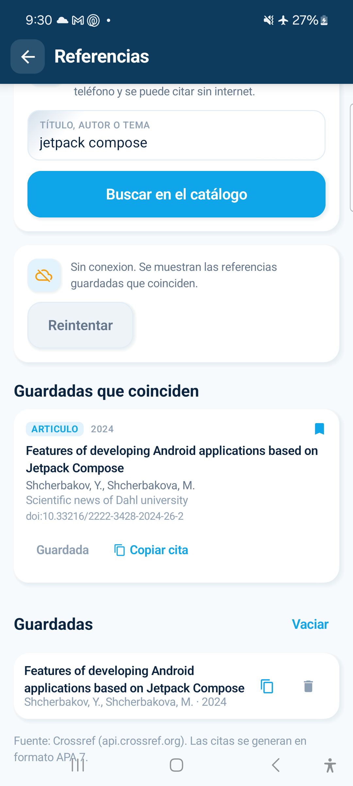
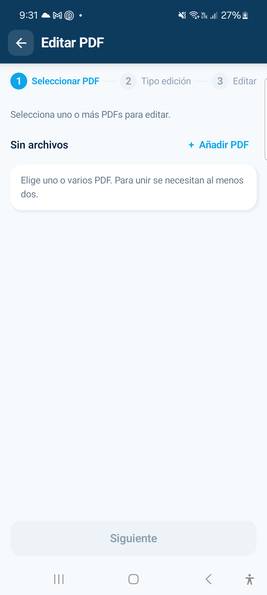
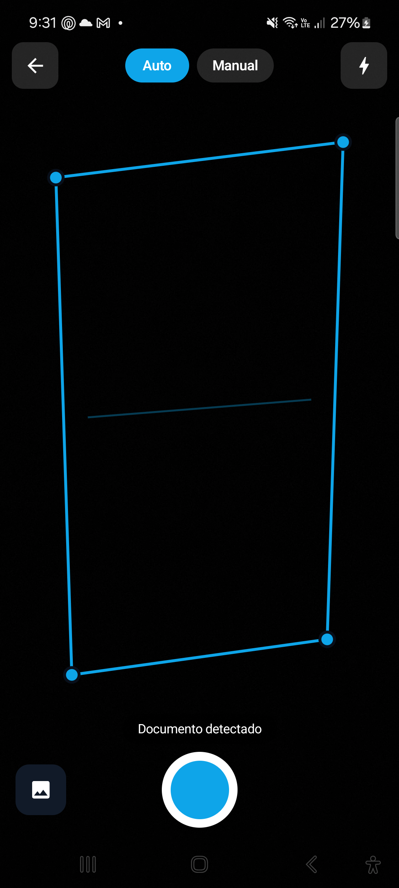
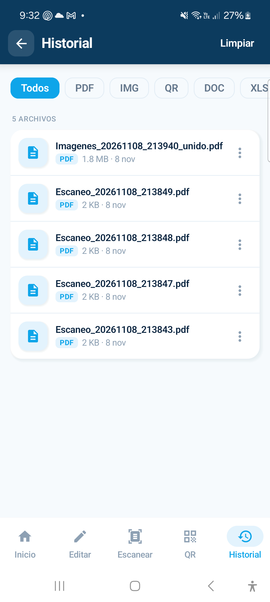
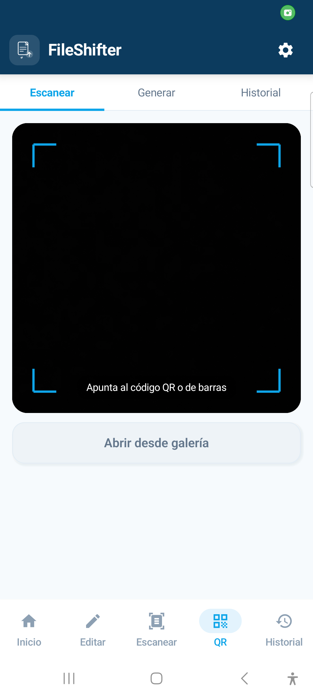

# FileShifter

**Suite ofimática para Android** — Kotlin + Jetpack Compose + Material 3.
Convierte, edita, escanea y valida documentos en el teléfono. Los archivos que
generas nunca salen del dispositivo; solo el buscador de bibliografía consulta
un catálogo abierto cuando hay conexión.

- **Alumno:** Carlos de Jesús Martínez Pineda
- **Matrícula:** 253432 — Grupo 4C
- **Materia:** Desarrollo de Aplicaciones Móviles
- **Arquitectura:** MVVM (View → ViewModel → Repository → Datos)
- **Versión:** 1.0.0

---

## Estado del proyecto

| Comprobación | Resultado |
| --- | --- |
| `./gradlew assembleDebug` | ✅ compila |
| Instalación en dispositivo real (SM-A525M, Android 14) | ✅ |
| Pruebas unitarias (`testDebugUnitTest`) | ✅ 10/10 (corrector y formatos) |
| Pruebas de extremo a extremo (`connectedDebugAndroidTest`) | ✅ 25/25 en el dispositivo |
| Conversión PDF → DOCX y DOCX → PDF verificada | ✅ contenido conservado |
| Archivos guardados en `Documentos/FileShifter` | ✅ visibles en el explorador |
| Consulta a Crossref con resultados en pantalla | ✅ verificado |
| Respaldo local del buscador sin conexión | ✅ verificado en modo avión |
| Conversión imagen → PDF verificada | ✅ PDF A4 de 1 página con la imagen |
| Rotación de PDF verificada | ✅ 2 páginas a 180° |
| Historial (Room) verificado | ✅ registro persistente |
| QR y portada de entrega verificados | ✅ archivos generados |

Detalle honesto de qué está terminado y qué falta: **[docs/ESTADO_ACTUAL.md](docs/ESTADO_ACTUAL.md)**.
Evidencias de la ejecución en el teléfono: **[docs/evidencias](docs/evidencias)**.

---

## Las funciones

| # | Función | Estado |
| --- | --- | --- |
| F1 | Convertir universal (PDF, DOCX, XLSX, PPTX, TXT, CSV, HTML, imágenes → PDF, TXT o DOCX) | ✅ |
| F2 | Imagen a PDF (unir o uno por imagen, desde galería o con la cámara) | ✅ |
| F3 | Editar PDF (unir, dividir, comprimir, rotar, eliminar, reordenar, marca de agua) | ✅ |
| F4 | Corrector ortográfico offline (tildes, repeticiones, errores frecuentes) | 🟡 básico |
| F5 | Modo Entrega (3 plantillas, formulario, vista previa, PDF) | 🟡 sin importar plantilla |
| F6 | Validador con semáforo, SHA-256 y QR | ✅ |
| F7 | Escáner con cámara + OCR + PDF | 🟡 sin detección de bordes |
| F8 | QR / barras (leer, generar, historial y abrir el enlace leído) | ✅ |
| F9 | **Referencias bibliográficas** (Crossref, cita APA y respaldo offline) | ✅ |

Extras: **Historial** con Room, **Ajustes** con DataStore y flujo configurable
(los interruptores ya ocultan las sugerencias de Corregir / Entrega / Validar
en las tarjetas de resultado).

---

## Consumo de API

F9 resuelve el problema de citar fuentes al armar un trabajo. En lugar de que el
alumno copie la bibliografía a mano, la app consulta el catálogo abierto
**Crossref**, que no pide llave ni registro.

```
GET https://api.crossref.org/works
    ?query.bibliographic=jetpack+compose
    &rows=12
    &select=DOI,title,author,issued,container-title,publisher,type
User-Agent: FileShifter/1.0 (mailto:charcraftycarlos@gmail.com)
```

La respuesta se mapea a un modelo propio (`Referencia`) con título, autores, año,
fuente, tipo y DOI. De ahí se arma la cita en formato APA 7.

El flujo completo queda así:

```
ReferenciasScreen → ReferenciasViewModel → ReferenciasRepository
                                            ├── CrossrefApi (Retrofit)
                                            └── ReferenciaDao (Room)
```

Puntos que se cuidaron:

- **Carga:** botón deshabilitado y aviso «Consultando el catálogo…» con indicador.
- **Errores:** mensaje entendible y botón **Reintentar**; el repositorio hace un
  segundo intento antes de rendirse.
- **Sin resultados:** texto de ayuda para cambiar la búsqueda (autor, una palabra
  del título o el DOI).
- **Sin conexión:** se muestran las referencias guardadas que coinciden con la
  consulta, con un aviso claro de que se está leyendo del dispositivo.
- **Persistencia:** lo guardado vive en Room (tabla `referencia`, versión 2 de la
  base de datos con su migración) y se puede borrar o vaciar.

---

## Evidencias

Ejecución real en un Galaxy A52 (SM-A525M, Android 14), 9 de noviembre de 2026.
Todas las capturas están en **[docs/evidencias](docs/evidencias)**.

<table>
  <tr>
    <td align="center"><br><sub>Inicio</sub></td>
    <td align="center"><br><sub>Modo Entrega</sub></td>
    <td align="center"><br><sub>Referencias (Crossref)</sub></td>
    <td align="center"><br><sub>Sin conexión</sub></td>
  </tr>
  <tr>
    <td align="center"><br><sub>Editar PDF</sub></td>
    <td align="center"><br><sub>Escáner</sub></td>
    <td align="center"><br><sub>Historial (Room)</sub></td>
    <td align="center"><br><sub>QR / Barras</sub></td>
  </tr>
</table>

---

## Arquitectura MVVM

```
View (Compose)  →  ViewModel  →  Repository  →  Datos
```

```
com.example.fileshifter
├── FileShifterApp.kt          # Application + AppContainer (inyección manual)
├── data
│   ├── model/                 # modelos puros (sin Android)
│   ├── local/                 # Room (historial, referencias) + DataStore (ajustes)
│   ├── source/                # PDFBox, Office, OCR, QR, archivos, Crossref
│   └── repository/            # Documento, Historial y Referencias
├── domain/                    # CorrectorOrtografico (lógica pura)
├── presentation
│   ├── home/ convert/ image/ edit/ corrector/
│   ├── delivery/ validator/ scanner/ qr/ history/ settings/ references/
│   └── common/                # pantalla base, cámara, componentes
├── navigation/AppNav.kt
└── ui/theme/                  # Material 3 celeste #0EA5E9 + neumorfismo
```

Reglas que se respetan en todo el código:

1. La pantalla **no** abre archivos ni convierte nada: manda eventos.
2. El **ViewModel** guarda el estado y llama al repositorio.
3. El **repositorio** es la única puerta a PDFBox, Room, DataStore, ML Kit y la red.
4. Los flujos de varios pasos (Editar, Entrega) comparten un ViewModel dentro
   de un grafo de navegación anidado.

Documento completo: **[docs/ARQUITECTURA_MVVM.md](docs/ARQUITECTURA_MVVM.md)**.

---

## Interfaz

La app reproduce el prototipo de Figma (`https://input-chop-13093493.figma.site`)
con un acabado neumórfico:

- Barra superior azul marino con el logotipo y el botón de regreso cuadrado.
- Franjas informativas celestes, tarjetas y chips con sombra suave.
- Pantalla de bienvenida con el logotipo, tres beneficios y botón **Comenzar**.
- Pasos numerados en Editar PDF y Modo Entrega; pestañas en QR.
- **Pantalla completa real (edge-to-edge)**: la app dibuja detrás de la barra de
  estado y de navegación, con insets correctos en notch, gestos y landscape.
- Rejilla adaptativa (2 o 3 columnas según el ancho) y contenido centrado con
  ancho máximo de 620 dp en tablets y plegables.
- **Icono de la app** con el logotipo: adaptive icon (fondo azul marino + tarjeta
  blanca con el documento), PNG para Android 7 y variante monocromática para
  iconos temáticos.

---

## Compilar y ejecutar

Requisitos: Android Studio, Android SDK 35, **JDK 21 para Gradle**.

> El daemon de Gradle se fija en Java 21 con
> `gradle/gradle-daemon-jvm.properties` porque el JDK 25 rompe el procesador
> KSP de Room. Si Gradle no encuentra el JDK, ajusta
> `org.gradle.java.installations.paths` en `gradle.properties`.

```bash
./gradlew assembleDebug                 # APK de depuración
./gradlew testDebugUnitTest             # lógica pura (corrector)
./gradlew connectedDebugAndroidTest     # PDFBox real en el teléfono
```

APK resultante: `app/build/outputs/apk/debug/app-debug.apk`.

---

## Pruebas

Las pruebas instrumentadas corren en el teléfono y trabajan con archivos reales:
escriben el origen, convierten con el repositorio y vuelven a abrir el resultado
para comprobar su contenido (páginas del PDF, texto del DOCX, hash SHA-256,
lectura del QR con ML Kit).

| Suite | Casos | Qué cubre |
| --- | --- | --- |
| `ConversionE2ETest` | 7 | DOCX, TXT, HTML y CSV a PDF; PDF a TXT y a DOCX; varios archivos |
| `FlujoDocumentosE2ETest` | 6 | Imagen a PDF, guardado en Documentos, historial, validador, QR y barras |
| `NavegacionE2ETest` | 6 | Bienvenida, inicio y apertura de cada herramienta |
| `PdfEngineTest` | 5 | Unir, dividir, rotar, marca de agua, rangos de páginas |
| `FormatosTest` (JVM) | 4 | Matriz de conversiones que ofrece la pantalla |

```bash
./gradlew connectedDebugAndroidTest   # 25 casos en el dispositivo
```

---

## Guardado de los archivos

Todo lo que genera la app se escribe en su carpeta privada y además se publica en
**`Documentos/FileShifter`**, para que el archivo se vea desde el explorador, se
pueda adjuntar a un correo o abrir con Word. En Android 10 o superior se usa
MediaStore, así que no hacen falta permisos de almacenamiento.

---

## Dependencias principales

| Área | Librería |
| --- | --- |
| UI | Jetpack Compose + Material 3 + Navigation Compose |
| Estado | Lifecycle ViewModel + StateFlow |
| Red | Retrofit + Gson (catálogo Crossref) |
| PDF | PDFBox-Android (`com.tom-roush`) |
| Office | Lector ZIP/XML propio (DOCX/XLSX/PPTX, sin macros) |
| OCR y códigos | ML Kit Text Recognition + Barcode Scanning |
| Cámara | CameraX |
| Datos | Room (historial, referencias) + DataStore (ajustes) |
| QR | ZXing core |

---

## Documentación

- `docs/ARQUITECTURA_MVVM.md` — capas, paquetes, inyección y flujos.
- `docs/ESTADO_ACTUAL.md` — auditoría de lo prometido vs. lo implementado.
- `docs/evidencias/` — capturas del funcionamiento en el teléfono.
- `README.md` — este archivo.
